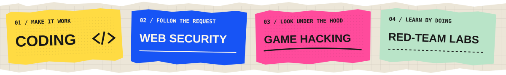

**4th-year BSIT student** / Cebu Institute of Technology – University

Hey, I'm **mrxception**. I enjoy coding and exploring offensive security, including game hacking, web security, penetration testing, and red-team labs.

This is my little corner for building things, following questions, and figuring out how systems work.

